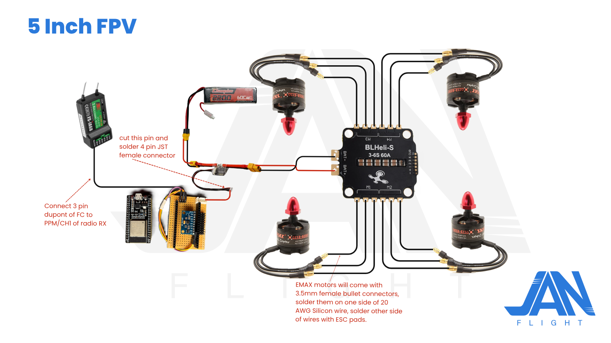
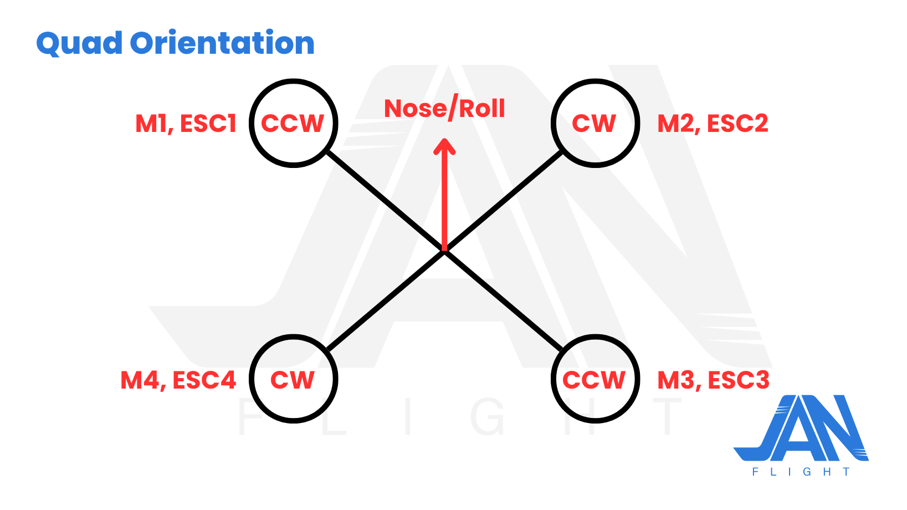
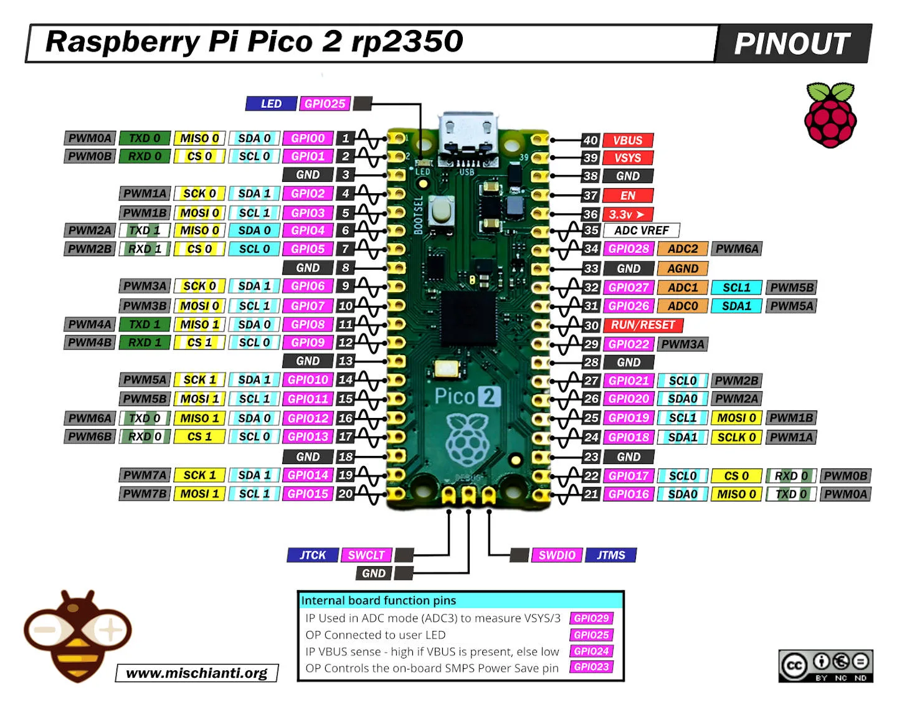
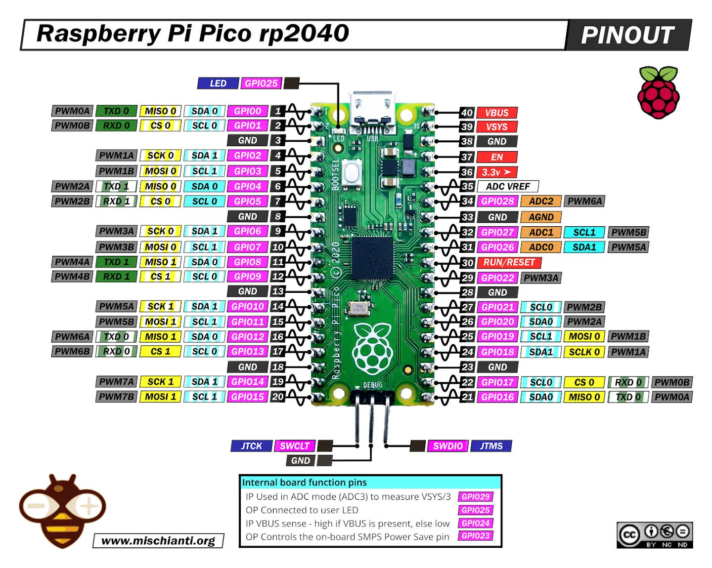
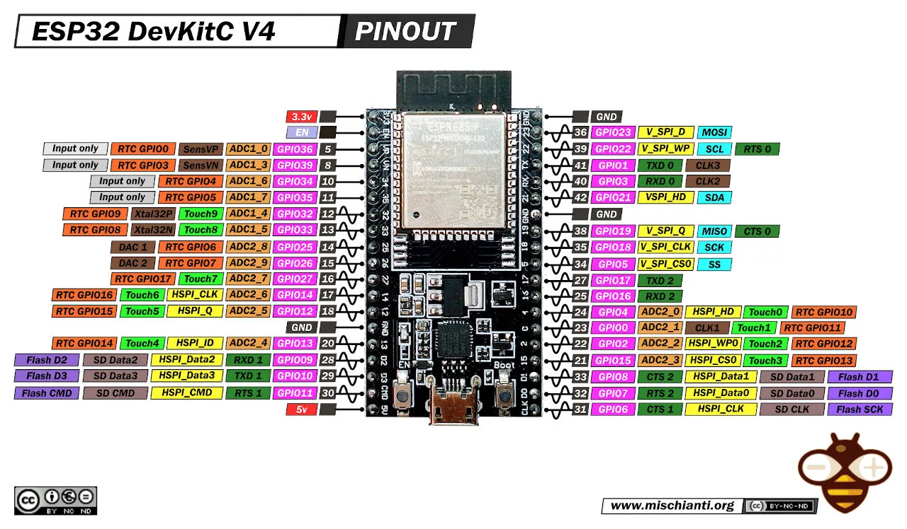
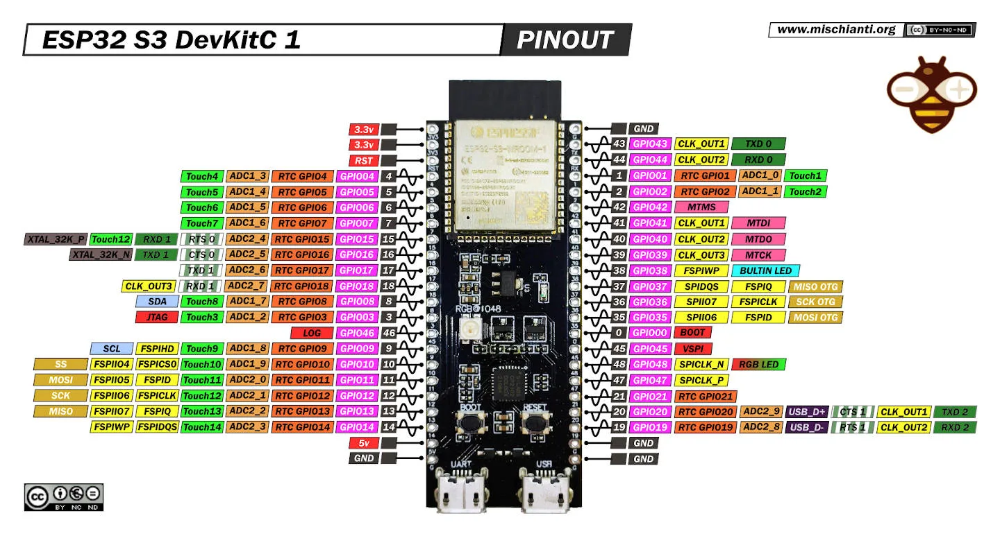
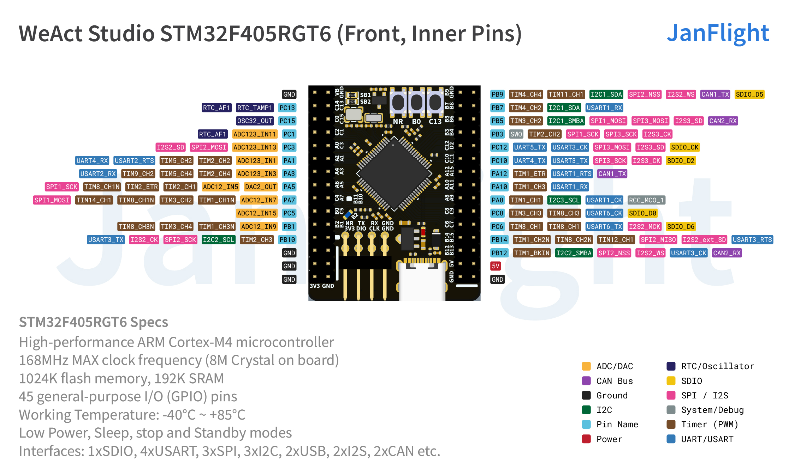
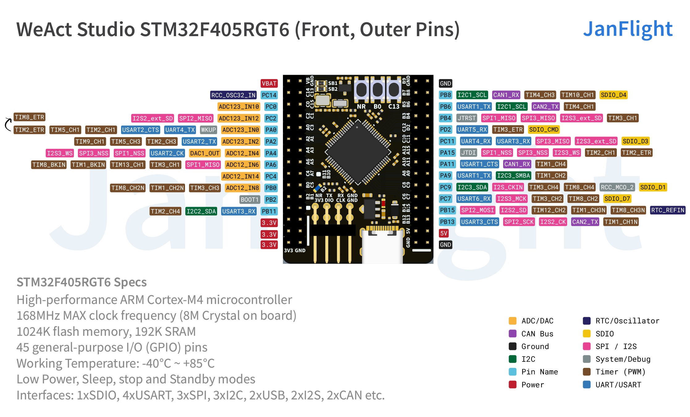

# 5 Inch FPV

In this example we will build 5 Inch FPV drone.

Make sure you've completed the [Initial Setup](content/initial-setup.md) Guide before proceeding with the steps below.

1. Get the required hardware
2. Make Connections
3. Configuration
4. Calibrate
5. Compile & Upload
6. FLY!

## 1. Get the required hardware

<table>
  <thead>
    <tr>
      <th>Part</th>
      <th>Specs</th>
      <th>Qty</th>
      <th>Price* (₹)</th>
      <th>Link (India)</th>
      <th>Price* ($)</th>
      <th>Link (Global)</th>
    </tr>
  </thead>
  <tbody>
    <tr>
      <td>Flight Controller</td>
      <td>Build guide for <a href="/content/rp2350-getting-started.md">RP2350</a>/<a href="/content/esp32-getting-started.md">ESP32</a>/<a href="/content/stm32-getting-started.md">STM32</a></td>
      <td>1</td>
      <td>-</td>
      <td>-</td>
      <td>-</td>
      <td>-</td>
    </tr>
    <tr>
      <td>Radio</td>
      <td>FlySky FS-i6 2.4G TX with FS-iA6B RX</td>
      <td>1</td>
      <td>5459</td>
      <td><a href="https://www.flyrobo.in/flysky-fs-i6-2.4g-6ch-afhds-transmitter-with-fs-ia6b-receiver-for-rc-fpv-drone?tracking=RlWmZUVohGHCRsAhWTrZyDfyKC3myArPWKC9tC7cAxOjEeW8PFqjN5SbOiOkNscf" target="_blank">Buy</a></td>
      <td>59.85</td>
      <td><a href="https://s.click.aliexpress.com/e/_c3IpqH2N" target="_blank">Buy</a></td>
    </tr>
    <tr>
      <td>Battery with Charger</td>
      <td>3S Lipo 2200mAh</td>
      <td>1</td>
      <td>1899</td>
      <td><a href="https://www.flyrobo.in/11.1v-2200mah-lipo-battery-with-imax-b3-lipo-balance-charger?tracking=RlWmZUVohGHCRsAhWTrZyDfyKC3myArPWKC9tC7cAxOjEeW8PFqjN5SbOiOkNscf" target="_blank">Buy</a></td>
      <td>17.06</td>
      <td><a href="https://s.click.aliexpress.com/e/_c4FYRYaD" target="_blank">Buy</a></td>
    </tr>
    <tr>
      <td rowspan="3">Frame (Choose Any one)</td>
      <td>Carbon Fiber Frame</td>
      <td>1</td>
      <td>1,113</td>
      <td><a href="https://www.flyrobo.in/zmr250_v2_carbon_fiber_frame_kit_rc?tracking=RlWmZUVohGHCRsAhWTrZyDfyKC3myArPWKC9tC7cAxOjEeW8PFqjN5SbOiOkNscf" target="_blank">Buy</a></td>
      <td>13.38</td>
      <td><a href="https://s.click.aliexpress.com/e/_c3SmxMVR" target="_blank">Buy</a></td>
    </tr>
    <tr>
      <td>3D printed Frame*</td>
      <td>1</td>
      <td colspan="4" style="text-align: center;"><a href="https://cad.onshape.com/documents/abe656e5f7593b350797ef41/w/374b23d28cbfc2ebeca6c97e/e/636e19702db9f859f6000e4b?renderMode=0&uiState=6acf389dbd6cfcbca776d6ee" target="_blank">View Model</a></td>
    </tr>
    <tr>
      <td>DIY</td>
      <td>1</td>
      <td colspan="4" style="text-align: center;"><i>Check my Instagram.</i></td>
    </tr>
    <tr>
      <td>Power Module</td>
      <td>XT60 Connector</td>
      <td>1</td>
      <td>570</td>
      <td><a href="https://www.flyrobo.in/apm_pixhawk_power_module_with_xt60?tracking=RlWmZUVohGHCRsAhWTrZyDfyKC3myArPWKC9tC7cAxOjEeW8PFqjN5SbOiOkNscf" target="_blank">Buy</a></td>
      <td>5.92</td>
      <td><a href="https://s.click.aliexpress.com/e/_c3ZEQCTb" target="_blank">Buy</a></td>
    </tr>
    <tr>
      <td>ESC</td>
      <td>60A BLHELI_S 4IN1 3-6S ESC</td>
      <td>1</td>
      <td>4,448</td>
      <td><a href="https://www.flyrobo.in/60a-blheli_s-4in1-3-6s-brushless-esc?tracking=RlWmZUVohGHCRsAhWTrZyDfyKC3myArPWKC9tC7cAxOjEeW8PFqjN5SbOiOkNscf" target="_blank">Buy</a></td>
      <td>38.98</td>
      <td><a href="https://s.click.aliexpress.com/e/_c3m2vKq1" target="_blank">Buy</a></td>
    </tr>
    <tr>
      <td rowspan="6">BLDC Motors</td>
      <td>Emax ECOII-2807-1300KV</td>
      <td>4</td>
      <td>1890</td>
      <td><a href="https://quartzcomponents.com/products/emax-ecoii-2807-1300kv-brushless-high-speed-dc-motor-for-drone?sca_ref=12138096.It1xJN1aww" target="_blank">Buy</a></td>
      <td>-</td>
      <td>-</td>
    </tr>
    <tr>
      <td>T-MOTOR VELOX V2 V2207.5 1950KV</td>
      <td>4</td>
      <td>1980</td>
      <td><a href="https://quartzcomponents.com/products/t-motor-velox-v2-v2207-5-1950kv-fpv-motor?pr_prod_strat=similar&pr_rec_id=00374a338&pr_rec_pid=8704253690090&pr_ref_pid=8704253886698&pr_seq=uniform&sca_ref=12138096.It1xJN1aww" target="_blank">Buy</a></td>
      <td>-</td>
      <td>-</td>
    </tr>
    <tr>
      <td>4 x T-Motor V2207 3.0 1750KV</td>
      <td>1</td>
      <td>-</td>
      <td>-</td>
      <td>104.31</td>
      <td><a href="https://s.click.aliexpress.com/e/_c4SfJuIp" target="_blank">Buy</a></td>
    </tr>
    <tr>
      <td>4 x Emax ECO II Series 2207 2400KV</td>
      <td>1</td>
      <td>-</td>
      <td>-</td>
      <td>80.29</td>
      <td><a href="https://s.click.aliexpress.com/e/_c4SfJuIp" target="_blank">Buy</a></td>
    </tr>
    <tr>
      <td rowspan="2">RS2205 2300kV (Buy 2 x CW and 2 x CCW)</td>
      <td>2</td>
      <td>729</td>
      <td><a href="https://www.flyrobo.in/2205-2300kv-brushless-motor-for-drone-cwclockwise-direction?tracking=RlWmZUVohGHCRsAhWTrZyDfyKC3myArPWKC9tC7cAxOjEeW8PFqjN5SbOiOkNscf" target="_blank">Buy</a></td>
      <td  rowspan="2">32.66</td>
      <td rowspan="2"><a href="https://s.click.aliexpress.com/e/_c3SYtzRn" target="_blank">Buy</a></td>
    </tr>
    <tr>
      <td>2</td>
      <td>729</td>
      <td><a href="https://www.flyrobo.in/2205-2300kv-brushless-motor-for-drone-cwclockwise-direction?tracking=RlWmZUVohGHCRsAhWTrZyDfyKC3myArPWKC9tC7cAxOjEeW8PFqjN5SbOiOkNscf" target="_blank">Buy</a></td>
    </tr>
    <tr>
      <td>Propellers</td>
      <td>5045/5146/5030 (I recommend one from Gemfan)</td>
      <td>2</td>
      <td>150</td>
      <td><a href="https://www.flyrobo.in/5045-5x4.5-3-blade-propeller-cw-plusccw-blue?tracking=RlWmZUVohGHCRsAhWTrZyDfyKC3myArPWKC9tC7cAxOjEeW8PFqjN5SbOiOkNscf" target="_blank">Buy</a></td>
      <td>2</td>
      <td><a href="https://s.click.aliexpress.com/e/_c4cHZ2fx" target="_blank">Buy</a></td>
    </tr>
    <tr>
      <td>Battery Strap</td>
      <td>20/30 cm</td>
      <td>1</td>
      <td>63</td>
      <td><a href="https://www.flyrobo.in/readytosky-30cm-nylon-strap-belt-for-rc-lipo-battery?tracking=RlWmZUVohGHCRsAhWTrZyDfyKC3myArPWKC9tC7cAxOjEeW8PFqjN5SbOiOkNscf" target="_blank">Buy</a></td>
      <td>0.39</td>
      <td><a href="https://s.click.aliexpress.com/e/_c4BgY7kZ" target="_blank">Buy</a></td>
    </tr>
    <tr>
      <td>Black Silicon Wire</td>
      <td>1 Meter, 20 AWG</td>
      <td>1</td>
      <td>26</td>
      <td><a href="https://www.flyrobo.in/20awg-high-flexible-black-silicone-wire-1-meter?tracking=RlWmZUVohGHCRsAhWTrZyDfyKC3myArPWKC9tC7cAxOjEeW8PFqjN5SbOiOkNscf" target="_blank">Buy</a></td>
      <td>1.09</td>
      <td><a href="https://s.click.aliexpress.com/e/_c3EOY7Oz" target="_blank">Buy</a></td>
    </tr>
  </tbody>
</table>

!> Not attached the FPV camera, VTX & VRX yet, If you wish to buy I recommend buying Foxxer T-rex or Caddx Ratel 2 or else DJI O4 Air Unit. Will be adding the Camera unit soon.

**I printed drone using PETG, one broke in a hard crash, and the other broke on a surprisingly soft landing. so, I switched to a quick DIY aluminum rod setup, which was way cheaper, faster to make, and far more crash-proof while I tune the flight code. I'm still confident an all-3D-printed frame is doable with the right geometry, print parameters and print orientation. so I'll definitely give it another shot in future*.

**prices as of 14th Oct 2026*

## 2. Make Connections

Make connections as per the following diagram.

The guide uses ESP32 as an example but it works similarly for Pico and STM32 Boards.

Refer to following diagram for the orientation of the drone.

For connecting ESC signal wires to flight controller refer to tables ([Pico](content/rp2350-hardware-setup?id=wiring) / [ESP32](content/esp32-hardware-setup?id=wiring) / [STM32](http://localhost:3000/#/content/stm32-hardware-setup?id=wiring)) of your target board. You may need to purchase appropriate connector for making connection between ESC and flight controller.

## 3. Configuration
Download [RP2350](https://github.com/oyegunmen/JanFlight/blob/main/src/RP2350/JanFlight_v1.0.0/JanFlight_v1.0.0.ino) / [ESP32](https://github.com/oyegunmen/JanFlight/blob/main/src/ESP32/JanFlight_v1.0.0/JanFlight_v1.0.0.ino) / [STM32](https://github.com/oyegunmen/JanFlight/blob/main/src/STM32/JanFlight_v1.0.0/JanFlight_v1.0.0.ino) based firmware from GitHub.

(a) **Update the Pin Declaration (Optional):** If you are using the default wiring, no changes are needed. If you are using custom pins, refer to your board’s pinout diagram, navigate to `Section 4` of the code, and update the pin declarations accordingly.

<!-- tabs:start -->

#### **RP2040 / RP2350**

#### **ESP32 / ESP32-S3**

#### **STM32**

<!-- tabs:end -->

b) **Adjust the Control Mixer (Optional):** Keep the default settings if you are building a standard QuadX drone. Locate the `controlMixer()` function and modify the `+ / -` signs to reflect your custom motor placement.

## 4. Calibrate

- Keep your Flight-Controller/IMU flat on a level surface.
- In `setup()`, uncomment the `calculate_IMU_error()` function.
- Connect your board via USB Data Cable, select your COM port, and click Upload.

> To enter bootloader mode on an RP2040 or RP2350, hold the BOOTSEL button while plugging it into your computer, then release it once the drive appears. For an ESP32, just plug the cable, the board automatically handles this when you flash your code.

Open the Serial Monitor, copy the printed offset values into the error variables in `section 3` of your code, and comment out `calculate_IMU_error()`.

!> Ensure the initial IMU offset errors in Section 3 are set to zero to allow for accurate calibration.

## 5. Compile & Upload
Connect your board via USB and Upload the code with calibrated IMU offset data.

!> You may need to tune the PID parameters in `Section 3` of the code to achieve optimal flight stability. If the drone feels sluggish or unresponsive, adjust these values to suit your specific build.

## 6. FLY!
Disconnect from your computer, double-check your failsafe and throttle cut switches with propellers off, verify the orientation, mount propellers, and head out for a test flight.

*Last Updated: 7th Aug 2026*