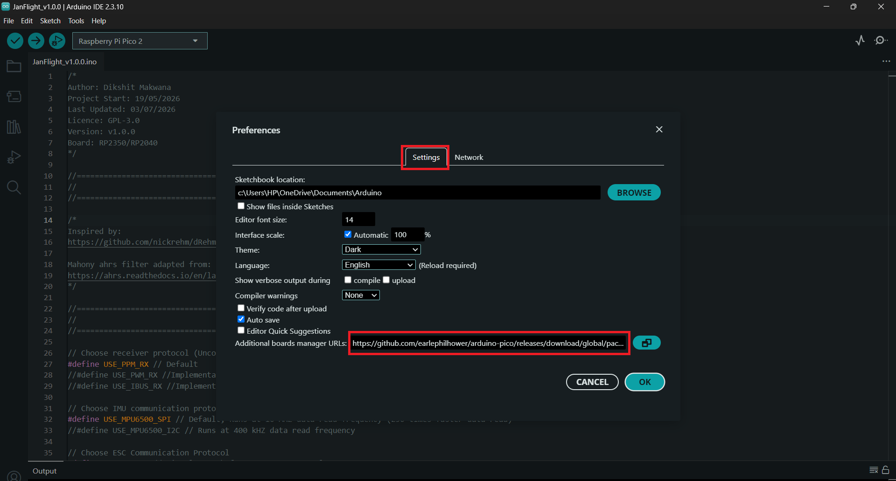
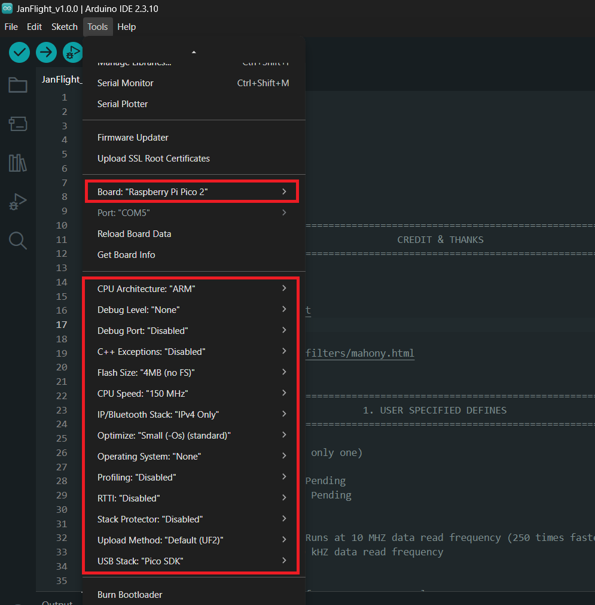
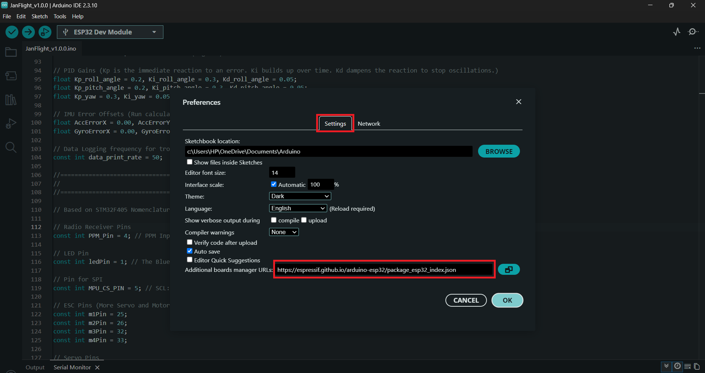
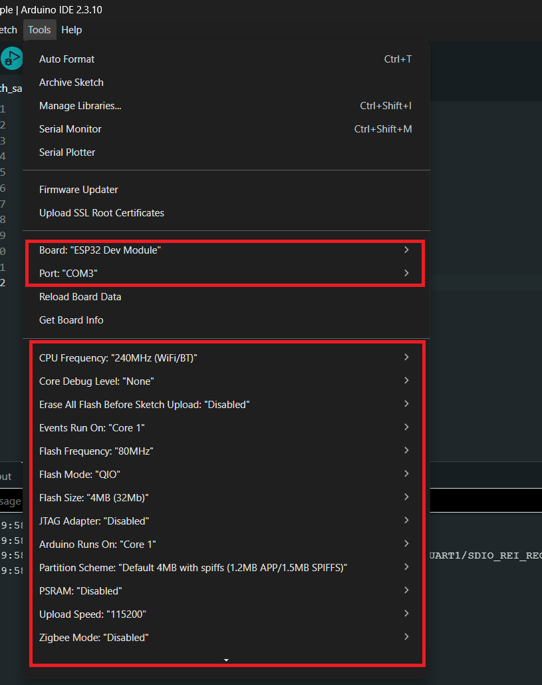
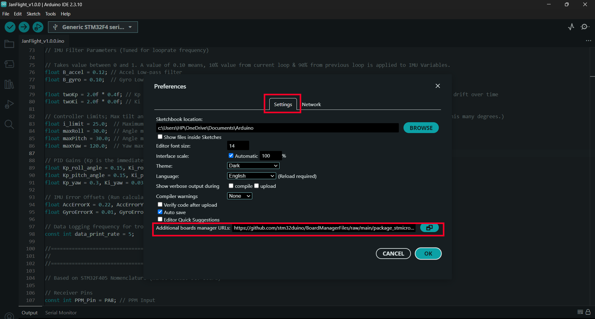
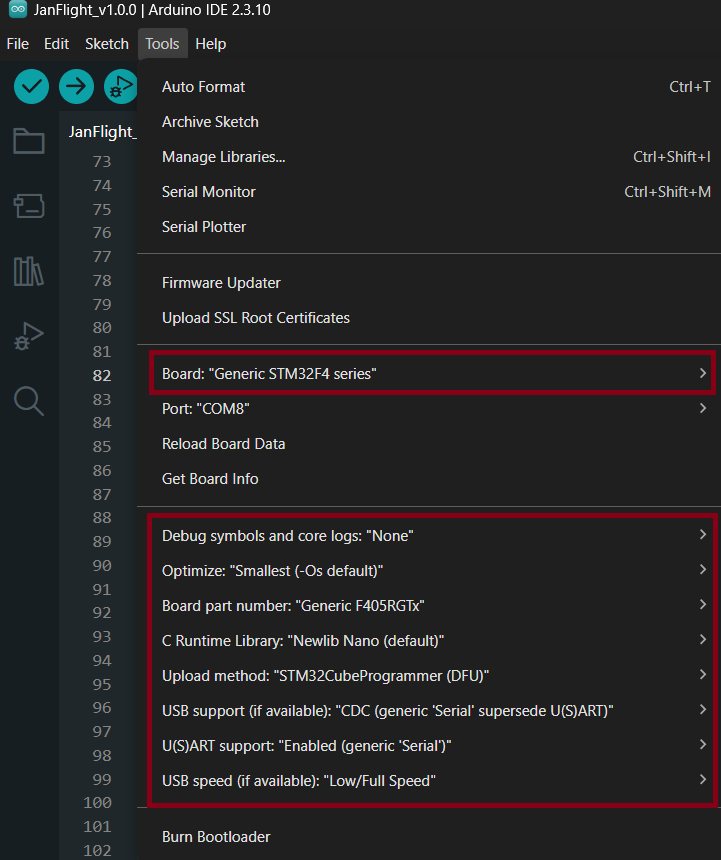

# Initial Setup

The initial Setup guide for your custom built flight controller.

### Development Environment

Download the latest version of the [Arduino IDE](https://www.arduino.cc/en/software/) for your operating system.

Select your target board from following tabs and follow the steps.

<!-- tabs:start -->

#### **RP2040 / RP2350**

Open your Arduino IDE and follow these steps to add RP2350 support:

1. Open Arduino IDE, go to **File > Preferences**. Under the Settings tab, locate the **Additional boards manager URLs** field and paste this exact link:

```Arduino
https://github.com/earlephilhower/arduino-pico/releases/download/global/package_rp2040_index.json
```



2. Open **Tools > Board > Boards Manager**. In the search bar, type **rp2040**. Locate **Raspberry Pi Pico/RP2040/RP2350** by Earle F. Philhower, III and click **Install**.

3. Go to **Tools > Board > Raspberry Pi RP2040/RP2350 Boards** and select **Raspberry Pi Pico 2**.

4. Go to **Tools > Port** and select the port your board enumerates.



#### **ESP32 / ESP32-S3**

Open your Arduino IDE and follow these steps to add ESP32 support:

1. Open Arduino IDE, go to **File > Preferences**. Under the Settings tab, locate the **Additional boards manager URLs** field and paste this exact link:

```Arduino
https://espressif.github.io/arduino-esp32/package_esp32_index.json
```



2. Open **Tools > Board > Boards Manager**. In the search bar, type **esp32**. Locate **esp32 by Espressif Systems** and click **Install**.

3. Go to **Tools > Board > ESP32 Arduino** and select **ESP32 Dev Module** (this matches most generic WROOM-32 DevKit boards; pick your board's exact name if listed separately).

4. Go to **Tools > Upload Speed** and set it to **115200**.

5. Go to **Tools > Port** and select the COM port your board enumerates as once connected via USB.



!> **Info**: Your laptop might need the Virtual COM Port driver installed if it doesn't automatically detect the board when flashing; the standard [CP210x](https://www.silabs.com/software-and-tools/usb-to-uart-bridge-vcp-drivers?tab=downloads)/[CH340](https://sparks.gogo.co.nz/ch340.html) driver for your OS should solve the detect issue.

#### **STM32**

Open your Arduino IDE and follow these steps to add STM32 support:

1. Open Arduino IDE, Go to **File > Preferences** Under the Settings tab, locate the **Additional boards manager URLs** field and paste this exact link:

```Arduino
https://github.com/stm32duino/BoardManagerFiles/raw/main/package_stmicroelectronics_index.json
```



2. Open **Tools > Board > Boards Manager**. In the search bar, type **STM32**. Locate STM32 MCU based boards by **STMicroelectronics** and click **Install**.

3. Go to **Tools > Board > STM32 Boards (STM32Duino)** and select **Generic STM32F4** series.

4. Go to **Tools > Board part number** and select **Generic F405RGTx**.

5. Go to **Tools > U(S)ART support** and change the setting to **Enabled (generic 'Serial')**. This activates USB CDC support so you can stream raw telemetry directly through your USB cable.



!> **Info**: Your laptop might need the [Virtual COM Port driver](https://www.st.com/en/development-tools/stsw-stm32102.html) installed if it doesn't automatically detect the board when flashing via DFU.

<!-- tabs:end -->

This completes your initial setup. From here on, all examples assume you have successfully completed this setup.

## Examples

Here are the current and planned build guides list:

- [x] [Quadcopter](content/quadcopter.md)
- [ ] 5 Inch FPV 
- [ ] Plane 
- [ ] Tricopter
- [ ] Monocopter
- [ ] Tailsitter

*Last Updated: 14th Sept 2026*