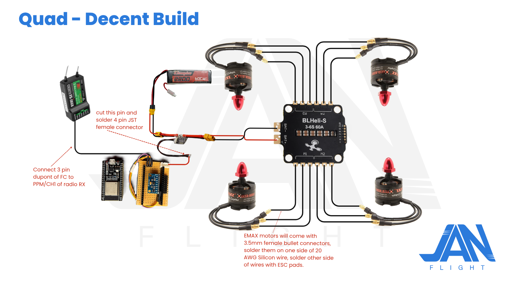
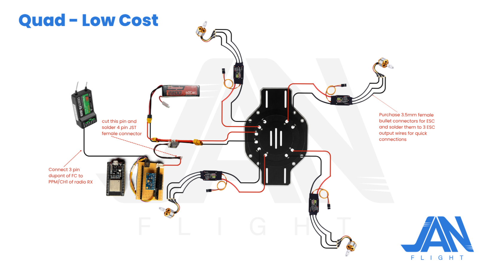

# Quadcopter

In this example we will build standard quadX drone.

Make sure you've completed the [Initial Setup](content/initial-setup.md) Guide before proceeding with the steps below.

1. Get the required hardware
2. Make Connections
3. Configuration
4. Calibrate
5. Compile & Upload
6. FLY!

## 1. Get the required hardware

<!-- tabs:start -->

#### **Decent Build**

<table>
  <thead>
    <tr>
      <th>Part</th>
      <th>Specs</th>
      <th>Qty</th>
      <th>Price* (₹)</th>
      <th>Link (India)</th>
      <th>Price* ($)</th>
      <th>Link (Global)</th>
    </tr>
  </thead>
  <tbody>
    <tr>
      <td>Flight Controller</td>
      <td>Build guide for <a href="/content/rp2350-getting-started.md">RP2350</a>/<a href="/content/esp32-getting-started.md">ESP32</a>/<a href="/content/stm32-getting-started.md">STM32</a></td>
      <td>1</td>
      <td>-</td>
      <td>-</td>
      <td>-</td>
      <td>-</td>
    </tr>
    <tr>
      <td>Radio</td>
      <td>FlySky FS-i6 2.4G TX with FS-iA6B RX</td>
      <td>1</td>
      <td>5459</td>
      <td><a href="https://www.flyrobo.in/flysky-fs-i6-2.4g-6ch-afhds-transmitter-with-fs-ia6b-receiver-for-rc-fpv-drone?tracking=RlWmZUVohGHCRsAhWTrZyDfyKC3myArPWKC9tC7cAxOjEeW8PFqjN5SbOiOkNscf" target="_blank">Buy</a></td>
      <td>59.85</td>
      <td><a href="https://s.click.aliexpress.com/e/_c3IpqH2N" target="_blank">Buy</a></td>
    </tr>
    <tr>
      <td>Battery with Charger</td>
      <td>3S Lipo 2200mAh</td>
      <td>1</td>
      <td>1899</td>
      <td><a href="https://www.flyrobo.in/11.1v-2200mah-lipo-battery-with-imax-b3-lipo-balance-charger?tracking=RlWmZUVohGHCRsAhWTrZyDfyKC3myArPWKC9tC7cAxOjEeW8PFqjN5SbOiOkNscf" target="_blank">Buy</a></td>
      <td>17.06</td>
      <td><a href="https://s.click.aliexpress.com/e/_c4FYRYaD" target="_blank">Buy</a></td>
    </tr>
    <tr>
      <td>Frame</td>
      <td>F450</td>
      <td>1</td>
      <td>599</td>
      <td><a href="https://www.flyrobo.in/dji-f450-quadcopter-frame-kit-with-integrated-pcb?tracking=RlWmZUVohGHCRsAhWTrZyDfyKC3myArPWKC9tC7cAxOjEeW8PFqjN5SbOiOkNscf" target="_blank">Buy</a></td>
      <td>14.01</td>
      <td><a href="https://s.click.aliexpress.com/e/_c36SA5Cv" target="_blank">Buy</a></td>
    </tr>
    <tr>
      <td>Power Module</td>
      <td>XT60 Connector</td>
      <td>1</td>
      <td>570</td>
      <td><a href="https://www.flyrobo.in/apm_pixhawk_power_module_with_xt60?tracking=RlWmZUVohGHCRsAhWTrZyDfyKC3myArPWKC9tC7cAxOjEeW8PFqjN5SbOiOkNscf" target="_blank">Buy</a></td>
      <td>5.92</td>
      <td><a href="https://s.click.aliexpress.com/e/_c3ZEQCTb" target="_blank">Buy</a></td>
    </tr>
    <tr>
      <td>ESC</td>
      <td>60A BLHELI_S 4IN1 3-6S ESC</td>
      <td>1</td>
      <td>4,448</td>
      <td><a href="https://www.flyrobo.in/60a-blheli_s-4in1-3-6s-brushless-esc?tracking=RlWmZUVohGHCRsAhWTrZyDfyKC3myArPWKC9tC7cAxOjEeW8PFqjN5SbOiOkNscf" target="_blank">Buy</a></td>
      <td>38.98</td>
      <td><a href="https://s.click.aliexpress.com/e/_c3m2vKq1" target="_blank">Buy</a></td>
    </tr>
    <tr>
      <td rowspan="3">BLDC Motors</td>
      <td>EMAX 935KV CCW MT2213 with 1045 Propeller</td>
      <td>2</td>
      <td>1398</td>
      <td><a href="https://www.flyrobo.in/emax-935kv-multicopter-motor-mt2213-with-propeller-pair-1045-brushless-motor?tracking=RlWmZUVohGHCRsAhWTrZyDfyKC3myArPWKC9tC7cAxOjEeW8PFqjN5SbOiOkNscf" target="_blank">Buy</a></td>
      <td>-</td>
      <td>-</td>
    </tr>
    <tr>
      <td>EMAX 935KV CW MT2213 with 1045 Propeller</td>
      <td>2</td>
      <td>1398</td>
      <td><a href="https://www.flyrobo.in/emax-935kv-cw-multicopter-motor-mt2213-with-propeller-pair-1045?tracking=RlWmZUVohGHCRsAhWTrZyDfyKC3myArPWKC9tC7cAxOjEeW8PFqjN5SbOiOkNscf" target="_blank">Buy</a></td>
      <td>-</td>
      <td>-</td>
    </tr>
    <tr>
      <td>Set of EMAX 935KV CW/CCW MT2213 with 1045 Propeller</td>
      <td>1</td>
      <td>-</td>
      <td>-</td>
      <td>53.26</td>
      <td><a href="https://s.click.aliexpress.com/e/_c3cqtllT" target="_blank">Buy</a></td>
    </tr>
    <tr>
      <td>Propellers</td>
      <td>Already Included with Motors</td>
      <td>-</td>
      <td>-</td>
      <td>-</td>
      <td>-</td>
      <td>-</td>
    </tr>
    <tr>
      <td>Battery Strap</td>
      <td>20/30 cm</td>
      <td>1</td>
      <td>63</td>
      <td><a href="https://www.flyrobo.in/readytosky-30cm-nylon-strap-belt-for-rc-lipo-battery?tracking=RlWmZUVohGHCRsAhWTrZyDfyKC3myArPWKC9tC7cAxOjEeW8PFqjN5SbOiOkNscf" target="_blank">Buy</a></td>
      <td>0.39</td>
      <td><a href="https://s.click.aliexpress.com/e/_c4BgY7kZ" target="_blank">Buy</a></td>
    </tr>
    <tr>
      <td>Black Silicon Wire</td>
      <td>1 Meter, 20 AWG</td>
      <td>1</td>
      <td>26</td>
      <td><a href="https://www.flyrobo.in/20awg-high-flexible-black-silicone-wire-1-meter?tracking=RlWmZUVohGHCRsAhWTrZyDfyKC3myArPWKC9tC7cAxOjEeW8PFqjN5SbOiOkNscf" target="_blank">Buy</a></td>
      <td>1.09</td>
      <td><a href="https://s.click.aliexpress.com/e/_c3EOY7Oz" target="_blank">Buy</a></td>
    </tr>
  </tbody>
</table>

#### **Low Cost Build**

<table>
  <thead>
    <tr>
      <th>Part</th>
      <th>Specs</th>
      <th>Qty</th>
      <th>Price* (₹)</th>
      <th>Link (India)</th>
      <th>Price* ($)</th>
      <th>Link (Global)</th>
    </tr>
  </thead>
  <tbody>
    <tr>
      <td>Flight Controller</td>
      <td>Build guide for <a href="/content/rp2350-getting-started.md">RP2350</a>/<a href="/content/esp32-getting-started.md">ESP32</a>/<a href="/content/stm32-getting-started.md">STM32</a></td>
      <td>1</td>
      <td>-</td>
      <td>-</td>
      <td>-</td>
      <td>-</td>
    </tr>
    <tr>
      <td>Radio</td>
      <td>FlySky FS-i6 2.4G TX with FS-iA6B RX</td>
      <td>1</td>
      <td>5459</td>
      <td><a href="https://www.flyrobo.in/flysky-fs-i6-2.4g-6ch-afhds-transmitter-with-fs-ia6b-receiver-for-rc-fpv-drone?tracking=RlWmZUVohGHCRsAhWTrZyDfyKC3myArPWKC9tC7cAxOjEeW8PFqjN5SbOiOkNscf" target="_blank">Buy</a></td>
      <td>59.85</td>
      <td><a href="https://s.click.aliexpress.com/e/_c3IpqH2N" target="_blank">Buy</a></td>
    </tr>
    <tr>
      <td>Battery with Charger</td>
      <td>3S Lipo 2200mAh</td>
      <td>1</td>
      <td>1899</td>
      <td><a href="https://www.flyrobo.in/11.1v-2200mah-lipo-battery-with-imax-b3-lipo-balance-charger?tracking=RlWmZUVohGHCRsAhWTrZyDfyKC3myArPWKC9tC7cAxOjEeW8PFqjN5SbOiOkNscf" target="_blank">Buy</a></td>
      <td>17.06</td>
      <td><a href="https://s.click.aliexpress.com/e/_c4FYRYaD" target="_blank">Buy</a></td>
    </tr>
    <tr>
      <td>Frame</td>
      <td>F450</td>
      <td>1</td>
      <td>599</td>
      <td><a href="https://www.flyrobo.in/dji-f450-quadcopter-frame-kit-with-integrated-pcb?tracking=RlWmZUVohGHCRsAhWTrZyDfyKC3myArPWKC9tC7cAxOjEeW8PFqjN5SbOiOkNscf" target="_blank">Buy</a></td>
      <td>14.01</td>
      <td><a href="https://s.click.aliexpress.com/e/_c36SA5Cv" target="_blank">Buy</a></td>
    </tr>
    <tr>
      <td>Power Module</td>
      <td>XT60 Connector</td>
      <td>1</td>
      <td>570</td>
      <td><a href="https://www.flyrobo.in/apm_pixhawk_power_module_with_xt60?tracking=RlWmZUVohGHCRsAhWTrZyDfyKC3myArPWKC9tC7cAxOjEeW8PFqjN5SbOiOkNscf" target="_blank">Buy</a></td>
      <td>5.92</td>
      <td><a href="https://s.click.aliexpress.com/e/_c3ZEQCTb" target="_blank">Buy</a></td>
    </tr>
    <tr>
      <td>ESC</td>
      <td>Emax BLHeli 20A</td>
      <td>4</td>
      <td>712</td>
      <td><a href="https://www.flyrobo.in/emax-blheli-20a-brushless-esc-for-rc-modelhigh-quality?tracking=RlWmZUVohGHCRsAhWTrZyDfyKC3myArPWKC9tC7cAxOjEeW8PFqjN5SbOiOkNscf" target="_blank">Buy</a></td>
      <td>9.23</td>
      <td><a href="https://s.click.aliexpress.com/e/_c4qHP1ot" target="_blank">Buy</a></td>
    </tr>
    <tr>
      <td>Brushless Motors</td>
      <td>A2212, 1000KV</td>
      <td>4</td>
      <td>413</td>
      <td><a href="https://www.flyrobo.in/a2212_1000kv_brushless_motor_for_rc_airplane?tracking=RlWmZUVohGHCRsAhWTrZyDfyKC3myArPWKC9tC7cAxOjEeW8PFqjN5SbOiOkNscf" target="_blank">Buy</a></td>
      <td>7.28</td>
      <td><a href="https://s.click.aliexpress.com/e/_c3MGVv7J" target="_blank">Buy</a></td>
    </tr>
    <tr>
      <td>Propellers</td>
      <td>1045</td>
      <td>3</td>
      <td>58</td>
      <td><a href="https://www.flyrobo.in/1045_propeller_10in_10x4.5_for_drone?tracking=RlWmZUVohGHCRsAhWTrZyDfyKC3myArPWKC9tC7cAxOjEeW8PFqjN5SbOiOkNscf" target="_blank">Buy</a></td>
      <td>1.24</td>
      <td><a href="https://s.click.aliexpress.com/e/_c4FyVCfT" target="_blank">Buy</a></td>
    </tr>
    <tr>
      <td>Battery Strap</td>
      <td>20/30 cm</td>
      <td>1</td>
      <td>63</td>
      <td><a href="https://www.flyrobo.in/readytosky-30cm-nylon-strap-belt-for-rc-lipo-battery?tracking=RlWmZUVohGHCRsAhWTrZyDfyKC3myArPWKC9tC7cAxOjEeW8PFqjN5SbOiOkNscf" target="_blank">Buy</a></td>
      <td>0.39</td>
      <td><a href="https://s.click.aliexpress.com/e/_c4BgY7kZ" target="_blank">Buy</a></td>
    </tr>
    <tr>
      <td>Bullet Connectors</td>
      <td>3.5mm Female</td>
      <td>12</td>
      <td>13</td>
      <td><a href="https://www.flyrobo.in/3.5mm-gold-plated-female-cross-bullet-banana-connector?tracking=RlWmZUVohGHCRsAhWTrZyDfyKC3myArPWKC9tC7cAxOjEeW8PFqjN5SbOiOkNscf" target="_blank">Buy</a></td>
      <td>0.26</td>
      <td><a href="https://s.click.aliexpress.com/e/_c4LuDjOl" target="_blank">Buy</a></td>
    </tr>
    <tr>
      <td>Black Silicon Wire</td>
      <td>1 Meter, 20 AWG</td>
      <td>1</td>
      <td>26</td>
      <td><a href="https://www.flyrobo.in/20awg-high-flexible-black-silicone-wire-1-meter?tracking=RlWmZUVohGHCRsAhWTrZyDfyKC3myArPWKC9tC7cAxOjEeW8PFqjN5SbOiOkNscf" target="_blank">Buy</a></td>
      <td>1.09</td>
      <td><a href="https://s.click.aliexpress.com/e/_c3EOY7Oz" target="_blank">Buy</a></td>
    </tr>
  </tbody>
</table>

<!-- tabs:end -->

**prices as of 14th Sept 2026*

## 2. Make Connections

Make connections as per the following diagram.

The guide uses ESP32 as an example but it works similarly for Pico and STM32 Boards.

<!-- tabs:start -->

#### **Decent Build**

#### **Low Cost Build**

<!-- tabs:end -->

Refer to following diagram for the orientation of the drone.

For connecting ESC signal wires to flight controller refer to tables ([Pico](content/rp2350-hardware-setup?id=wiring) / [ESP32](content/esp32-hardware-setup?id=wiring) / [STM32](http://localhost:3000/#/content/stm32-hardware-setup?id=wiring)) of your target board.

## 3. Configuration
Download [RP2350](https://github.com/oyegunmen/JanFlight/blob/main/src/RP2350/JanFlight_v1.0.0/JanFlight_v1.0.0.ino) / [ESP32](https://github.com/oyegunmen/JanFlight/blob/main/src/ESP32/JanFlight_v1.0.0/JanFlight_v1.0.0.ino) / [STM32](https://github.com/oyegunmen/JanFlight/blob/main/src/STM32/JanFlight_v1.0.0/JanFlight_v1.0.0.ino) based firmware from GitHub.

(a) **Update the Pin Declaration (Optional):** If you are using the default wiring, no changes are needed. If you are using custom pins, refer to your board’s pinout diagram, navigate to `Section 4` of the code, and update the pin declarations accordingly.

<!-- tabs:start -->

#### **RP2040 / RP2350**

#### **ESP32 / ESP32-S3**

#### **STM32**

<!-- tabs:end -->

b) **Adjust the Control Mixer (Optional):** Keep the default settings if you are building a standard QuadX drone. Locate the `controlMixer()` function and modify the `+ / -` signs to reflect your custom motor placement.

## 4. Calibrate

- Keep your Flight-Controller/IMU flat on a level surface.
- In `setup()`, uncomment the `calculate_IMU_error()` function.
- Connect your board via USB Data Cable, select your COM port, and click Upload.

> To enter bootloader mode on an RP2040 or RP2350, hold the BOOTSEL button while plugging it into your computer, then release it once the drive appears. For an ESP32, just plug the cable, the board automatically handles this when you flash your code.

Open the Serial Monitor, copy the printed offset values into the error variables in `section 3` of your code, and comment out `calculate_IMU_error()`.

!> Ensure the initial IMU offset errors in Section 3 are set to zero to allow for accurate calibration.

## 5. Compile & Upload
Connect your board via USB and Upload the code with calibrated IMU offset data.

!> You may need to tune the PID parameters in `Section 3` of the code to achieve optimal flight stability. If the drone feels sluggish or unresponsive, adjust these values to suit your specific build.

## 6. FLY!
Disconnect from your computer, double-check your failsafe and throttle cut switches with propellers off, verify the orientation, mount propellers, and head out for a test flight.

*Last Updated: 7th Aug 2026*